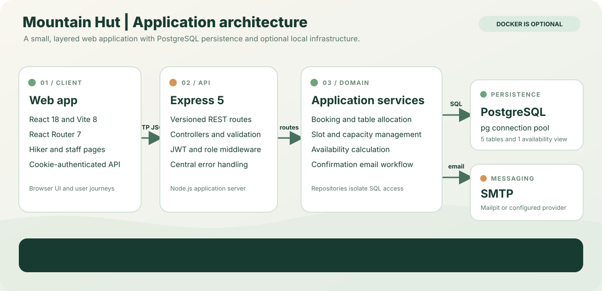
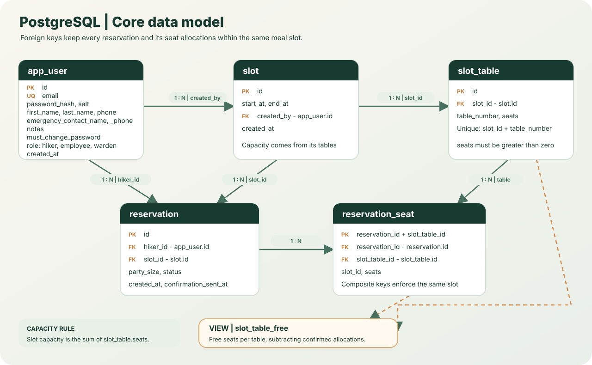
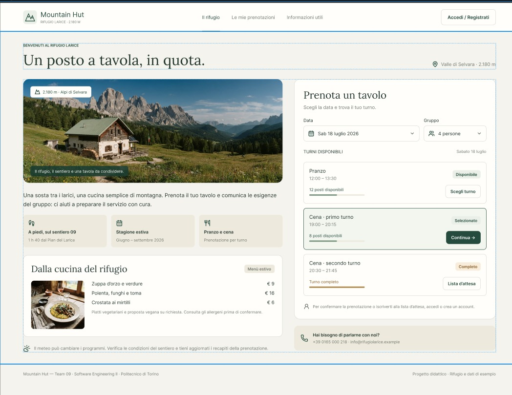

# Mountain Hut | Team 09

<div align="center">
  <p><strong>A digital companion for hikers and mountain-hut staff.</strong></p>
  
  <p><strong>React 18</strong> · <strong>Vite 8</strong> · <strong>Express 5</strong> · <strong>PostgreSQL</strong></p>
</div>

> **Implementation scope:** the current codebase implements the MH-01 to MH-04 vertical slice: table booking, slot capacity, confirmation emails, and availability checks. MH-05 to MH-19 are tracked product requirements, not claims about completed functionality.

Developed by Team 09 as the semester project for the **Software Engineering II** course at Politecnico di Torino.

**Explore:** [Architecture](#architecture) · [Data model](#data-model) · [Getting started](#local-postgresql-no-docker) · [Tests](#tests)

## About the project

Mountain huts offer food, shelter and a place to sleep to people travelling in the mountains. Space, supplies and staff time are limited, and visitors' plans change with the weather. Requests arrive through the web, by phone or in person, which makes it easy for staff to lose track of changes or overbook the hut.

This application gives hikers and the hut team a shared, up-to-date view of what is booked and what is still available. Hikers can plan their stop with confidence. Staff can make good use of limited resources and keep track of the guests they are expecting.

### Who uses it

| Role         | Description                                                                  |
| ------------ | ---------------------------------------------------------------------------- |
| **User**     | Anyone visiting the public web pages.                                        |
| **Hiker**    | A registered user who books services for themselves or on behalf of a party. |
| **Employee** | A member of the hut team handling day-to-day operations.                     |
| **Warden**   | The hut manager. Oversees services and can do everything an employee can.    |

### Current implementation

| Story | Implemented capability | Main behavior |
| --- | --- | --- |
| MH-01 | Book a table | A hiker books a party into a meal slot; seats are allocated to the slot's tables. |
| MH-02 | Define slot capacity | Staff define meal slots and their table and seat layout. |
| MH-03 | Receive confirmation | The backend attempts to email a booking confirmation after the reservation succeeds. |
| MH-04 | Check availability | Visitors can query remaining seats; this read is advisory and does not hold capacity. |

Stories MH-05 to MH-19 remain part of the product requirements and roadmap. Their presence in the story list below does not mean they are implemented in this codebase.

See [context.md](context.md) for the full domain description and terminology.

### Technical guides for MH-01 to MH-04

| Story | Technical guide |
| --- | --- |
| MH-01 - Book a table | [Booking flow, allocation, transaction, and API](documentation/stories_detail/MH-01-book-a-table.md) |
| MH-02 - Define slot capacity | [Slot creation, table layouts, validation, and concurrency](documentation/stories_detail/MH-02-define-slot-capacity.md) |
| MH-03 - Receive confirmation | [Email trigger, delivery semantics, and SMTP configuration](documentation/stories_detail/MH-03-receive-confirmation.md) |
| MH-04 - Check availability | [Public availability query and seating calculation](documentation/stories_detail/MH-04-check-availability.md) |

## Architecture

<p align="center">
  <a href="documentation/images/architecture-overview.svg">
    
  </a>
</p>

The browser communicates with a versioned Express API. The backend separates routes, controllers, services, and PostgreSQL repositories. Reservation confirmation uses SMTP; Docker Compose can provide PostgreSQL and Mailpit locally, but is not required when equivalent local services are available.

| Layer | Responsibility |
| --- | --- |
| Frontend | React pages for hikers and staff; cookie-authenticated API requests |
| API | Express routes, request handling, authentication, role checks, and error responses |
| Domain | Booking allocation, slot/table management, availability calculations, and email workflow |
| Persistence | PostgreSQL accessed through the `pg` connection pool |
| Messaging | Nodemailer sends confirmation emails through a configured SMTP server |

See the [backend architecture and component reference](App/backend/README.md) and [API documentation](documentation/api.md) for more detail.

## Data model

<p align="center">
  <a href="documentation/images/data-model.svg">
    
  </a>
</p>

The schema has seven tables and one derived view: `app_user`, `slot`, `slot_table`, `reservation`, `reservation_seat`, `reservation_requirement`, `password_reset_token`, and `slot_table_free`. Slot capacity is the sum of its table seat counts. The availability view calculates remaining seats from confirmed allocations. Composite foreign keys ensure a reservation cannot allocate a table from a different slot.

The complete schema is in [`schema.sql`](App/docker/postgres/schema.sql); see the [database reference](documentation/database.md) for keys, constraints, and query behavior.

## Technology stack

| Area | Stack |
| --- | --- |
| Frontend | React 18, React Router 7, Vite 8, Tailwind CSS 4 |
| Backend | Node.js, Express 5, ES modules, `tsx` |
| Authentication | JSON Web Tokens in HTTP-only cookies |
| Database | PostgreSQL via `pg`; Docker Compose uses PostgreSQL 16 |
| Email | Nodemailer and React Email over SMTP |
| Frontend tests | Vitest and Testing Library |
| Backend tests | Node.js test runner with `tsx` |

The versions above follow the package manifests. Local PostgreSQL 17 has also been verified. See the [frontend guide](App/frontend/README.md), [backend guide](App/backend/README.md), and [App documentation index](App/README.md).

<details>
  <summary>View the original home-page design prototype</summary>
  <p align="center">
    
  </p>
  <p><em>This is an early design reference in Italian, not a screenshot of the current application. Feature implementation varies by user story.</em></p>
</details>

## Database setup

The backend uses PostgreSQL (`pg`), not MySQL. Docker is optional. The no-Docker workflow below uses a local PostgreSQL service and PowerShell commands from the repository root.

### Local PostgreSQL (no Docker)

1. Start the local PostgreSQL service. Create an application role and an empty database using an administrator connection:

   ```sql
   CREATE ROLE mountainhut_app LOGIN PASSWORD 'replace-with-a-local-password';
   CREATE DATABASE mountainhut_db OWNER mountainhut_app;
   ```

   Replace the example password with a private local value. Do not commit it.

2. Create `App\docker\.env` from the example only if the file does not already exist:

   ```powershell
   if (-not (Test-Path 'App\docker\.env')) {
       Copy-Item 'App\docker\.env.example' 'App\docker\.env'
   }
   ```

   Set `DB_HOST=localhost`, `DB_PORT=5432`, `DB_USER=mountainhut_app`, `DB_NAME=mountainhut_db`, and `DB_PASSWORD` to the password used above. Replace the example `JWT_SECRET` with a private development value. Keep `.env` local and uncommitted.

3. Apply the schema once to the new, empty database:

   ```powershell
   psql -h localhost -p 5432 -U mountainhut_app -d mountainhut_db -f App\docker\postgres\schema.sql
   ```

   `schema.sql` is not a migration runner; apply it only when initializing an empty database. See [database documentation](documentation/database.md).

4. In two PowerShell terminals, start the backend and frontend:

   ```powershell
   Set-Location .\App\backend
   npm install
   npm run dev
   ```

   ```powershell
   Set-Location .\App\frontend
   npm install
   npm run dev
   ```

   Open `http://localhost:5173`. The backend listens on `http://localhost:4000`.

Without a local SMTP server, MH-01 bookings still commit, but MH-03 may return `confirmationSent: false`. Configure a reachable SMTP provider or use the optional Docker Mailpit setup below.

### Optional Docker database setup

1. Create the database environment file:

   ```bash
   cp App/docker/.env.example App/docker/.env
   ```

2. Edit `App/docker/.env` and set `DB_USER` and `DB_PASSWORD` to your preferred credentials. You can also change `DB_NAME` and `DB_PORT` if needed.
3. Change to the Docker configuration directory and start the database:

   ```bash
   cd App/docker
   docker compose up -d db
   ```

   On the first startup, PostgreSQL creates the database and the tables automatically.

4. Check that the database is running and that its tables have been created. The command reads the database user and name from the container configuration:

   ```bash
   docker compose ps
   docker compose exec db sh -c 'psql -U "$POSTGRES_USER" -d "$POSTGRES_DB" -c "\dt"'
   ```

### Test data (development only; Docker Compose)

`docker-compose.dev.yml` also loads the test data in `App/docker/postgres/seed.sql`. To start the database with it, run from `App/docker`:

```bash
docker compose -f docker-compose.yml -f docker-compose.dev.yml down -v
docker compose -f docker-compose.yml -f docker-compose.dev.yml up -d db
```

`down -v` deletes the existing data, because PostgreSQL runs the schema and seed scripts only when the database is created for the first time.

The test slots are dated relative to the day the seed runs, so after a few days they are in the past. To refresh them without recreating the database, run the seed again. It deletes all the data and inserts it again:

```bash
docker compose exec -T db sh -c 'psql -U "$POSTGRES_USER" -d "$POSTGRES_DB"' < postgres/seed.sql
```

#### Test users

The seed creates these users. Use them to log in to the app. They are for development only: never use these passwords anywhere else.

| Role     | Name           | Email                            | Password       |
| -------- | -------------- | -------------------------------- | -------------- |
| warden   | Marco Rossi    | `warden@rifugio.it`              | `Warden123!`   |
| employee | Giulia Bianchi | `giulia@rifugio.it`              | `Employee123!` |
| employee | Luca Verdi     | `luca@rifugio.it`                | `Employee123!` |
| hiker    | Anna Neri      | `mountainhut.09+anna@gmail.com`  | `Hiker123!`    |
| hiker    | Paolo Gallo    | `mountainhut.09+paolo@gmail.com` | `Hiker123!`    |
| hiker    | Sara Conti     | `mountainhut.09+sara@gmail.com`  | `Hiker123!`    |
| hiker    | Tom Smith      | `mountainhut.09+tom@gmail.com`   | `Hiker123!`    |

The hikers use plus addresses of the project Gmail account, so their confirmation emails all arrive in the `mountainhut.09@gmail.com` inbox.

Stop the database without deleting its data:

```bash
docker compose down
```

### Emails (development only)

After a booking, the backend sends a confirmation email (MH-03) over SMTP. In development, `docker-compose.dev.yml` starts [Mailpit](https://mailpit.axllent.org/), a fake SMTP server that keeps every email in a local inbox, so no real email is sent.

1. Check that `App/docker/.env` contains the SMTP settings from `.env.example`. The default values point to Mailpit:

   | Variable                       | Default                                    | Description                                  |
   | ------------------------------ | ------------------------------------------ | -------------------------------------------- |
   | `SMTP_HOST`                    | `localhost`                                | SMTP server                                  |
   | `SMTP_PORT`                    | `1025`                                     | SMTP port                                    |
   | `SMTP_SECURE`                  | `false`                                    | `true` for TLS connections (usually port 465) |
   | `SMTP_USER`, `SMTP_PASSWORD`   | empty                                      | Credentials, not needed by Mailpit           |
   | `MAIL_FROM`                    | `"Mountain Hut <noreply@mountainhut.local>"` | Sender of the emails                         |

2. Start Mailpit together with the database, from `App/docker`:

   ```bash
   docker compose -f docker-compose.yml -f docker-compose.dev.yml up -d
   ```

3. Open the inbox at http://localhost:8025. Mailpit keeps the emails in memory, so they are lost when it restarts.

#### Sending real emails

To deliver real emails (e.g. for a demo), use the project Gmail account `mountainhut.09@gmail.com`. Set these values in `App/docker/.env`:

```
SMTP_HOST=smtp.gmail.com
SMTP_PORT=465
SMTP_SECURE=true
SMTP_USER=mountainhut.09@gmail.com
SMTP_PASSWORD=<app password>
MAIL_FROM="Mountain Hut <mountainhut.09@gmail.com>"
```

- `SMTP_PASSWORD` is a Gmail **app password** (16 characters, no spaces), not the account password. Ask the team for it. Never commit it.
- Restart the backend after changing `.env`: `npm run dev` does not reload it.
- If sending fails, the booking still succeeds and the response contains `"confirmationSent": false`. The reason is in the backend log.

## Running the backend

The backend reads its settings from `App/docker/.env`. It runs with [tsx](https://tsx.is/) instead of plain `node`, because the email templates are written in JSX. From `App/backend`:

```bash
npm install
npm run dev     # restarts on every change
npm start       # single run
npm test        # tests, with JSX support
```

The server listens on port 4000. At startup the log shows how many variables were loaded from `App/docker/.env`.

The integration and end-to-end tests use the database configured in `App/docker/.env`, so start it before `npm test`. They delete the rows they create, and they never send real emails: the email tests use a fake inbox started by the test itself.

## Tests

Run the frontend suite and production build from `App\frontend`:

```powershell
npm test
npm run build
```

Run backend tests from `App\backend` with the PostgreSQL service and `App\docker\.env` configured:

```powershell
npm test
```

The backend tests use the Node.js test runner. Database-backed tests clean up the rows they create, and email tests use a local fake inbox instead of sending real mail.

## License

This project is licensed under the **GNU General Public License v3.0 or later (GPL-3.0-or-later)**. See the [LICENSE](LICENSE) file for the full text.

We chose GPL-3.0 because we want our software, and every modified version of it, to remain free software. Anyone may use, study, modify and redistribute it, even commercially, but anyone who distributes it or a derivative work must release the full source code under the same license. This ensures that improvements are shared back with the community and that our code cannot be turned into a closed, proprietary product.
