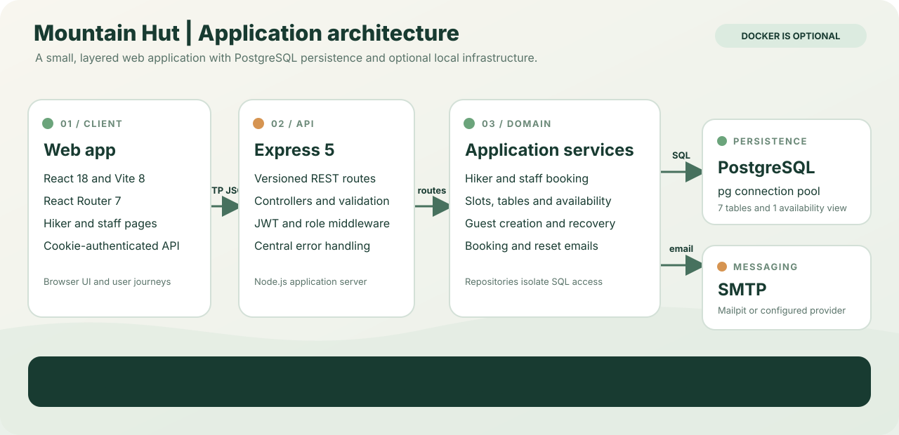
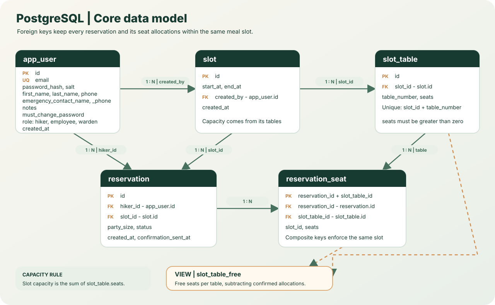
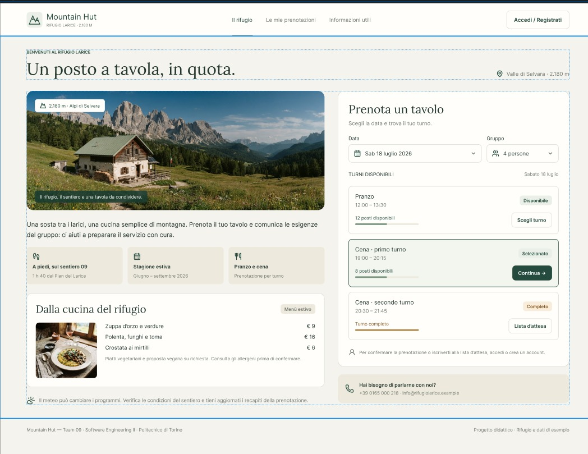

# Mountain Hut | Team 09

<div align="center">
  <p><strong>A digital companion for hikers and mountain-hut staff.</strong></p>
  
  <p><strong>React 18</strong> · <strong>Vite 8</strong> · <strong>Express 5</strong> · <strong>PostgreSQL</strong></p>
</div>

The application includes MH-01 through MH-08, employee accounts with mandatory password changes, and email password recovery. See the [implementation status](documentation/implementation-status.md).

Developed by Team 09 as the semester project for the **Software Engineering II** course at Politecnico di Torino.

**Explore:** [Run with Docker](#run-the-release-with-docker) · [Documentation index](documentation/README.md) · [Architecture](#architecture) · [Data model](#data-model) · [Getting started](#local-postgresql-no-docker) · [Tests](#tests)

## About the project

Mountain huts offer food, shelter and a place to sleep to people travelling in the mountains. Space, supplies and staff time are limited, and visitors' plans change with the weather. Requests arrive through the web, by phone or in person, which makes it easy for staff to lose track of changes or overbook the hut.

This application gives hikers and the hut team a shared, up-to-date view of what is booked and what is still available. Hikers can plan their stop with confidence. Staff can make good use of limited resources and keep track of the guests they are expecting.

### Who uses it

| Role         | Description                                                                  |
| ------------ | ---------------------------------------------------------------------------- |
| **User**     | Anyone visiting the public web pages.                                        |
| **Hiker**    | A registered user booking for a party, or a temporary guest recorded by staff without login access. |
| **Employee** | A member of the hut team handling day-to-day operations.                     |
| **Warden**   | The hut manager. Oversees services and can do everything an employee can.    |

### Current implementation

| Story | Implemented capability | Main behavior |
| --- | --- | --- |
| MH-01 | Book a table | A hiker books a party into a meal slot; seats are allocated to the slot's tables. |
| MH-02 | Define slot capacity | Staff define meal slots and their table and seat layout. |
| MH-03 | Receive confirmation | The backend attempts to email a booking confirmation after the reservation succeeds. |
| MH-04 | Check availability | Visitors can query remaining seats; this read is advisory and does not hold capacity. |
| MH-05 | Party requirements | When booking, a hiker lists dietary restrictions and allergies for parts of the party, each with an allergy flag; staff see the bookings of each day with tables and requirements, allergies highlighted. |
| MH-06 | Change a booking | A hiker sees their current and upcoming bookings and changes the slot, party size or requirements up to 48 hours before the slot; seats are reassigned and an update email is sent. |
| MH-07 | Reserve for a hiker | Staff book for an existing hiker, a new full account, or a temporary guest. A new full account changes its temporary password at first sign-in. Email recovery links can be used once and expire after 24 hours. |
| MH-08 | Cancel a booking | Hikers cancel their own bookings and staff cancel on their behalf until the slot ends. Cancellation releases seats and sends an email when the hiker has an email address. |

MH-09 (repeat a weekly schedule), MH-10 (define menus), MH-11 (view meal details) and MH-20 (register a hike) are planned for sprint 3: their API and database design is in the [API reference](documentation/api.md) and the [database reference](documentation/database.md), but they are not implemented yet. The other stories remain product requirements.

See [context.md](context.md) for the full domain description and terminology.

### Technical guides

| Story | Technical guide |
| --- | --- |
| MH-01 - Book a table | [Booking flow, allocation, transaction, and API](documentation/stories_detail/MH-01-book-a-table.md) |
| MH-02 - Define slot capacity | [Slot creation, table layouts, validation, and concurrency](documentation/stories_detail/MH-02-define-slot-capacity.md) |
| MH-03 - Receive confirmation | [Email trigger, delivery semantics, and SMTP configuration](documentation/stories_detail/MH-03-receive-confirmation.md) |
| MH-04 - Check availability | [Public availability query and seating calculation](documentation/stories_detail/MH-04-check-availability.md) |
| MH-05 - Party requirements | [Requirement rules, staff bookings list, and pages](documentation/stories_detail/MH-05-party-requirements.md) |
| MH-06 - Change a booking | [Change rules, seat reassignment, concurrency, and pages](documentation/stories_detail/MH-06-change-a-booking.md) |
| MH-07 - Reserve for a hiker | [Staff booking, temporary guests, full accounts, and password recovery](documentation/stories_detail/MH-07-reserve-for-a-hiker.md) |
| MH-08 - Cancel a booking | [Cancel a booking](documentation/stories_detail/MH-08-cancel-a-booking.md) |

## Architecture

<p align="center">
  <a href="documentation/images/architecture-overview.svg">
    
  </a>
</p>

The browser communicates with a versioned Express API. The backend separates routes, controllers, services, and PostgreSQL repositories. Staff booking reuses table allocation and confirmation delivery, while a separate recovery email sends password-reset links. Docker Compose can provide PostgreSQL and Mailpit locally, but is not required when equivalent local services are available.

| Layer | Responsibility |
| --- | --- |
| Frontend | React pages for hikers and staff; cookie-authenticated API requests |
| API | Express routes, request handling, authentication, role checks, and error responses |
| Domain | Hiker/staff booking allocation, guest creation, slot/table management, availability, and password recovery |
| Persistence | PostgreSQL accessed through the `pg` connection pool |
| Messaging | Nodemailer sends booking confirmation, update, cancellation, and password-reset emails through configured SMTP |

See the [backend architecture and component reference](App/backend/README.md) and [API documentation](documentation/api.md) for more detail.

## Data model

<p align="center">
  <a href="documentation/images/data-model.svg">
    
  </a>
</p>

The schema has seven tables and one derived view: `app_user`, `slot`, `slot_table`, `reservation`, `reservation_seat`, `reservation_requirement`, `password_reset_token`, and `slot_table_free`. Regular users have credentials; temporary hikers have neither email nor password. Staff-entered reservations record `created_by`. Recovery tokens are stored only as hashes. Slot capacity is the sum of its table seat counts; the availability view subtracts confirmed allocations. Composite foreign keys keep every reservation and its tables in the same slot.

The complete schema is in [`schema.sql`](App/docker/postgres/schema.sql); see the [database reference](documentation/database.md) for keys, constraints, and query behavior.

## Technology stack

| Area | Stack |
| --- | --- |
| Frontend | React 18, React Router 7, Vite 8, Tailwind CSS 4 |
| Backend | Node.js, Express 5, ES modules, `tsx` |
| Authentication | JSON Web Tokens in HTTP-only cookies |
| Database | PostgreSQL via `pg`; Docker Compose uses PostgreSQL 16 |
| Email | Nodemailer and React Email over SMTP |
| Frontend tests | Vitest and Testing Library |
| Backend tests | Node.js test runner with `tsx` |

The package manifests and lockfiles record dependency versions. The local preview and tests were verified with Node.js 22.14, npm 10.9, and PostgreSQL 17. See the [frontend guide](App/frontend/README.md), [backend guide](App/backend/README.md), and [App documentation index](App/README.md).

<details>
  <summary>View the original home-page design prototype</summary>
  <p align="center">
    
  </p>
  <p><em>This is an early design reference in Italian, not a screenshot of the current application. Feature implementation varies by user story.</em></p>
</details>

## Run the release with Docker

One Docker image with everything: the app, the API, PostgreSQL with test data, and a [Mailpit](https://mailpit.axllent.org/) inbox with a copy of every email. It runs on Intel/AMD and ARM.

**Image:** [`mountainhutteam09/mountainhut:latest`](https://hub.docker.com/r/mountainhutteam09/mountainhut), the newest release. Each sprint's zip runs that sprint's exact version.

### Start

1. Install [Docker Desktop](https://www.docker.com/products/docker-desktop/) (or Docker Engine on Linux), start it, and wait until it says **Engine running** (bottom left of its window).
2. Unzip `Team09-secrets.zip` from the Elaborati section of the portal. It has `secrets.env`, the passwords the container needs (use it as it is, don't edit it, and keep it private; they are not in the image or this repository), and `HOW-TO-RUN.txt`, these steps on one page for that sprint's version.
3. Open a terminal in that folder. On macOS, open Terminal, type `cd ` (with a space), drag the folder into the window and press Enter. On Windows, right-click inside the folder and choose **Open in Terminal** (on Windows 10: Shift + right-click, **Open PowerShell window here**). Then copy all lines of the command for your system. On macOS and Linux:

   ```bash
   docker run -d --pull always --name mountainhut \
     --env-file secrets.env \
     -p 127.0.0.1:8080:8080 -p 127.0.0.1:8025:8025 \
     -v mountainhut-data:/var/lib/postgresql/data \
     mountainhutteam09/mountainhut:latest
   ```

   On Windows, in PowerShell:

   ```powershell
   docker run -d --pull always --name mountainhut `
     --env-file secrets.env `
     -p 127.0.0.1:8080:8080 -p 127.0.0.1:8025:8025 `
     -v mountainhut-data:/var/lib/postgresql/data `
     mountainhutteam09/mountainhut:latest
   ```

   The first time, Docker downloads the image (a few minutes). Then the command prints a long id: that is normal, the app is starting.

4. In the same terminal, run `docker ps` every few seconds until the STATUS of the `mountainhut` line says `Up ... (healthy)` (10–20 seconds; Docker Desktop shows it under **Containers** too). If it says `(unhealthy)`, or the line is missing, see [If something goes wrong](#if-something-goes-wrong). Then open in your browser:
   - the app: <http://localhost:8080>
   - the email inbox: <http://localhost:8025> (booking confirmations, updates, cancellations and password-reset links)
5. Sign in with one of the [test users](#test-users) below, or register a hiker with your own email address.

`127.0.0.1` keeps the app and the inbox private to your computer. Every email appears in Mailpit and is also sent to its real address through the project Gmail account: the test hikers' emails go to the team inbox, the staff test emails stay in Mailpit. To receive the emails in your own mailbox, register a new hiker with your own address.

### Test users

The test data includes these accounts. They are test accounts: never use these passwords anywhere else.

| Role            | Name           | Email                            | Password                   | Must change password |
| --------------- | -------------- | -------------------------------- | -------------------------- | -------------------- |
| warden          | Marco Rossi    | `warden@rifugio.it`              | `Warden123!`               | No                   |
| employee        | Giulia Bianchi | `giulia@rifugio.it`              | `Employee123!`             | No                   |
| employee        | Luca Verdi     | `luca@rifugio.it`                | `Employee123!`             | No                   |
| employee        | Alessandro Serra | `alessandro@rifugio.it`          | `Fake123!`                 | Yes                  |
| hiker           | Anna Neri      | `mountainhut.09+anna@gmail.com`  | `Hiker123!`                | No                   |
| hiker           | Paolo Gallo     | `mountainhut.09+paolo@gmail.com` | `Hiker123!`                | No                   |
| hiker           | Sara Conti      | `mountainhut.09+sara@gmail.com`   | `Hiker123!`                | No                   |
| hiker           | Tom Smith       | `mountainhut.09+tom@gmail.com`    | `Hiker123!`                | No                   |
| hiker           | Elena Fontana   | `mountainhut.09+elena@gmail.com`  | `Fake123!`                 | Yes                  |
| temporary hiker | Giovanni Riva | N/A                              | Cannot log in              | N/A                  |

Alessandro and Elena must change their temporary password at first sign-in. Giovanni is a guest recorded by staff and cannot sign in.

### What to try

| Role | Test users | Stories |
| --- | --- | --- |
| Visitor | none | Check availability (MH-04), register |
| Hiker | Anna, Paolo, Sara, Tom | Book with party requirements (MH-01, MH-05), get the confirmation email (MH-03), change or cancel it under **My bookings** (MH-06, MH-08) |
| Employee | Giulia, Luca | Define slots and tables (MH-02), see a day's bookings (MH-05), reserve for a hiker (MH-07), cancel for a hiker (MH-08) |
| Warden | Marco | Everything an employee does, plus employee accounts |

**Forgot password?** on the sign-in page sends a reset link to Mailpit.

### Manage the container

| Task | Command |
| --- | --- |
| Logs | `docker logs -f mountainhut` |
| Stop, start again (data is kept) | `docker stop mountainhut`, `docker start mountainhut` |
| Fresh test data, or a new release | `docker rm -f mountainhut`, `docker volume rm mountainhut-data`, then step 3 |
| Database shell | `docker exec -it mountainhut psql -U mountainhut -d mountainhut_db` |

If you get a new `secrets.env`, for example from a newer zip, run `docker rm -f mountainhut` and step 3 again: a restart keeps the old values. The data is kept.

### If something goes wrong

| Problem | Fix |
| --- | --- |
| Port 8080 or 8025 already in use | `docker rm -f mountainhut`, then step 3 with the `-p` line replaced by `-p 127.0.0.1:18080:8080 -p 127.0.0.1:18025:8025 -e CLIENT_URL=http://localhost:18080`, and open <http://localhost:18080> and <http://localhost:18025> |
| `open secrets.env: no such file or directory` | Open the terminal in the folder that contains `secrets.env` (step 3) and run the command again |
| `The container name "/mountainhut" is already in use` | `docker start mountainhut`, or remove it as in "Fresh test data" |
| The `mountainhut` line is missing from `docker ps` (the container stopped) | `docker logs mountainhut` says why. For `Missing DB_PASSWORD JWT_SECRET`, unzip `secrets.env` again from the zip and check the command has `--env-file secrets.env`. Then `docker rm mountainhut` and step 3 |
| `docker ps` says `(unhealthy)` | Start from scratch: `docker rm -f mountainhut`, `docker volume rm mountainhut-data`, then step 3 |
| No email in a real inbox, or an email takes about 10 seconds | The copy is in Mailpit. Look for `Email relay off` or `[relay] error` in `docker logs mountainhut`, then run `docker restart mountainhut`. Also check the spam folder |

To build or publish the image, see the [Docker release guide](documentation/docker-release.md).

## Database setup

The backend connects to PostgreSQL through `pg`. The local workflow below uses PowerShell from the repository root. If `psql` is unavailable on Windows, add the PostgreSQL `bin` directory to `PATH` or invoke `psql.exe` by its full path.

### Local PostgreSQL (no Docker)

1. Start the local PostgreSQL service. Create an application role and an empty database using an administrator connection:

   ```sql
   CREATE ROLE mountainhut_app LOGIN PASSWORD 'replace-with-a-local-password';
   CREATE DATABASE mountainhut_db OWNER mountainhut_app;
   ```

   Replace the example password with a private local value. Do not commit it.

2. Create `App\docker\.env` from the example only if the file does not already exist:

   ```powershell
   if (-not (Test-Path 'App\docker\.env')) {
       Copy-Item 'App\docker\.env.example' 'App\docker\.env'
   }
   ```

   Set `DB_HOST=localhost`, `DB_PORT=5432`, `DB_USER=mountainhut_app`, `DB_NAME=mountainhut_db`, and `DB_PASSWORD` to the password used above. Replace the example `JWT_SECRET` with a private development value. Set `CLIENT_URL=http://localhost:5173` for browser CORS and password-reset links. Keep `.env` local and uncommitted.

3. Apply the schema once to the new, empty database:

   ```powershell
   psql -X -v ON_ERROR_STOP=1 -h localhost -p 5432 -U mountainhut_app -d mountainhut_db -f App\docker\postgres\schema.sql
   ```

   `schema.sql` is not a migration runner; apply it only when initializing an empty database. See [database documentation](documentation/database.md).

4. For a demo with [test users and future meal slots](#test-users), load the seed into the new disposable database before starting the app. The seed replaces existing data in the target schema.

   ```powershell
   psql -X -v ON_ERROR_STOP=1 -h localhost -p 5432 -U mountainhut_app -d mountainhut_db -f App\docker\postgres\seed.sql
   ```

5. Open two PowerShell terminals at the repository root, one for the backend and one for the frontend.

   ```powershell
   Set-Location .\App\backend
   npm.cmd ci
   $env:HOST = '127.0.0.1'
   npm.cmd run dev
   ```

   ```powershell
   Set-Location .\App\frontend
   npm.cmd ci
   npm.cmd run dev -- --host 127.0.0.1 --port 5173 --strictPort
   ```

   Open [the frontend](http://localhost:5173). The API base URL is `http://localhost:4000/api/v1`. Use `localhost` in your browser so it matches `CLIENT_URL`.

Without a local SMTP server, bookings still commit, but may return `confirmationSent: false`. Password-reset requests still return `202` for valid input, but no usable recovery link reaches the user. Configure a reachable SMTP provider or use the optional Docker Mailpit setup below.

### Optional Docker database setup

1. Create the database environment file:

   ```bash
   cp App/docker/.env.example App/docker/.env
   ```

2. Edit `App/docker/.env` and set `DB_USER` and `DB_PASSWORD` to your preferred credentials. You can also change `DB_NAME` and `DB_PORT` if needed.
3. Change to the Docker configuration directory and start the database:

   ```bash
   cd App/docker
   docker compose up -d db
   ```

   On the first startup, PostgreSQL creates the database and the tables automatically.

4. Check that the database is running and that its tables have been created. The command reads the database user and name from the container configuration:

   ```bash
   docker compose ps
   docker compose exec db sh -c 'psql -U "$POSTGRES_USER" -d "$POSTGRES_DB" -c "\dt"'
   ```

### Test data (development only; Docker Compose)

`docker-compose.dev.yml` adds `App/docker/postgres/seed.sql` to PostgreSQL's initialization scripts. Use the following command from `App/docker` with a fresh volume.

```bash
docker compose -f docker-compose.yml -f docker-compose.dev.yml up -d db
```

PostgreSQL only runs those scripts when it initializes the database. The seed places meal slots relative to the day it runs. To refresh them in a disposable development database, run the seed again. This replaces the contents:

```bash
docker compose exec -T db sh -c 'psql -v ON_ERROR_STOP=1 -U "$POSTGRES_USER" -d "$POSTGRES_DB"' < postgres/seed.sql
```

The seed creates the [test users](#test-users) listed in the release section.

Stop the database without deleting its data:

```bash
docker compose down
```

### Emails (development only)

In development, `docker-compose.dev.yml` can start Mailpit, a fake SMTP server that captures confirmation, update, cancellation, and password recovery emails in a local inbox. [Mailpit documentation](https://mailpit.axllent.org/)

1. Check that `App/docker/.env` contains the SMTP settings from `.env.example`. The default values point to Mailpit:

   | Variable                       | Default                                    | Description                                  |
   | ------------------------------ | ------------------------------------------ | -------------------------------------------- |
   | `SMTP_HOST`                    | `localhost`                                | SMTP server                                  |
   | `SMTP_PORT`                    | `1025`                                     | SMTP port                                    |
   | `SMTP_SECURE`                  | `false`                                    | `true` for TLS connections (usually port 465) |
   | `SMTP_USER`, `SMTP_PASSWORD`   | empty                                      | Credentials, not needed by Mailpit           |
   | `MAIL_FROM`                    | `"Mountain Hut <noreply@mountainhut.local>"` | Sender of the emails                         |

2. Start Mailpit from `App/docker`. This command works with a local PostgreSQL installation or the Compose database.

   ```bash
   docker compose -f docker-compose.yml -f docker-compose.dev.yml up -d mailpit
   ```

3. Open [the Mailpit inbox](http://localhost:8025). With this Compose configuration, captured emails are lost when the container is recreated. Recovery links use `CLIENT_URL`. Staff see each generated temporary password once on the reservation result screen. Temporary guests have no email address.

#### Sending real emails

To deliver real emails (e.g. for a demo), use the project Gmail account `mountainhut.09@gmail.com`. Set these values in `App/docker/.env`:

```
SMTP_HOST=smtp.gmail.com
SMTP_PORT=465
SMTP_SECURE=true
SMTP_USER=mountainhut.09@gmail.com
SMTP_PASSWORD=<app password>
MAIL_FROM="Mountain Hut <mountainhut.09@gmail.com>"
```

- `SMTP_PASSWORD` is a Gmail **app password** (16 characters, no spaces), not the account password. Ask the team for it. Never commit it.
- Restart the backend after changing `.env`: `npm run dev` does not reload it.
- If sending fails, the booking still succeeds and the response contains `"confirmationSent": false`. The reason is in the backend log.

## Running the backend

The backend reads its settings from `App/docker/.env`. It runs with [tsx](https://tsx.is/) instead of plain `node`, because the email templates are written in JSX. From `App/backend`:

```bash
npm ci
npm run dev     # restarts on every change
npm start       # single run
npm run test:isolated -- --test-concurrency=1
```

The server listens on port 4000. At startup the log shows how many variables were loaded from `App/docker/.env`.

Database-backed tests require the PostgreSQL connection in `App/docker/.env`. Prefer `npm run test:isolated -- --test-concurrency=1` so fixture cleanup runs in a temporary schema. Email tests use mocks or local fake inboxes.

## Tests

Run the frontend suite and production build from `App\frontend`:

```powershell
npm.cmd test
npm.cmd run build
```

Run backend tests from `App\backend` with PostgreSQL and `App\docker\.env` configured, using a fresh isolated schema:

```powershell
npm.cmd run test:isolated -- --test-concurrency=1
```

The backend tests use the Node.js test runner. The database role needs permission to create schemas. `npm test` also exists, but runs directly against the configured database. On Windows, use `npm.cmd` if PowerShell blocks `npm.ps1`.

See the [testing guide](documentation/testing.md#latest-validation) for the latest suite, build, and browser results.

## License

This project is licensed under the **GNU General Public License v3.0 or later (GPL-3.0-or-later)**. See the [LICENSE](LICENSE) file for the full text.

We chose GPL-3.0 because we want our software, and every modified version of it, to remain free software. Anyone may use, study, modify and redistribute it, even commercially, but anyone who distributes it or a derivative work must release the full source code under the same license. This ensures that improvements are shared back with the community and that our code cannot be turned into a closed, proprietary product.
