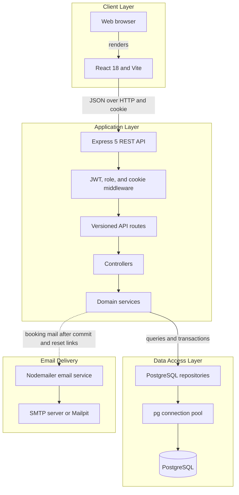
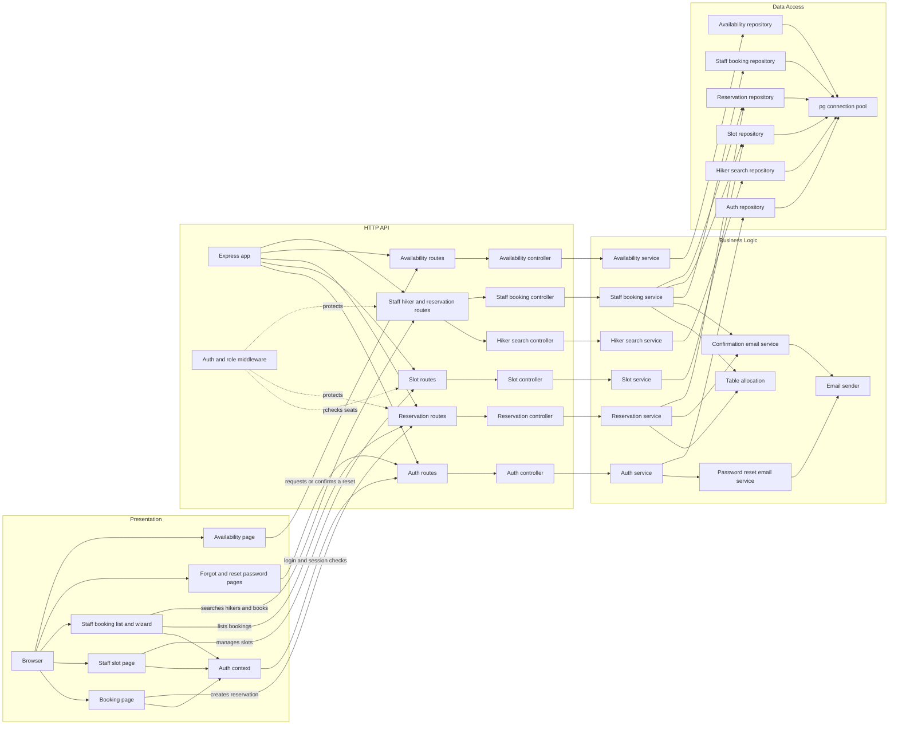

# Architecture Diagram

Mountain Hut is a client-server web application. The React client calls an Express API, which coordinates booking and guest services, PostgreSQL transactions, and booking/recovery email delivery. This describes `mh07/feat/main`; read the [implementation status](implementation-status.md) for employee/password regressions and the MH-08 integration boundary.

## Application Architecture

<!-- mermaid-checked: no \n, no em-dash/en-dash, no {} in labels, subgraphs are id["label"], arrows are -->|"label"|, all subgraphs closed by end, ids unique -->

### Technology and Data Storage

| Area | Technology | Responsibility |
| --- | --- | --- |
| Frontend | React 18, React Router 7, Vite 8, Tailwind CSS 4 | Hiker and staff user interfaces |
| Backend | Node.js, Express 5, ES modules, `tsx` | Versioned HTTP API and server startup |
| Authentication | JSON Web Tokens in HTTP-only cookies | Current role/password flag loaded from PostgreSQL per protected request |
| Persistence | PostgreSQL through `pg` | Regular/temporary hikers, slots, tables, reservations, requirements, and reset tokens |
| Email | Nodemailer and React Email | Booking confirmation/update and password-reset messages |
| Frontend tests | Vitest and Testing Library | Component and interaction tests |
| Backend tests | Node.js test runner with `tsx` | Service and API tests |

PostgreSQL is the only application database. The repository's Docker Compose configuration uses PostgreSQL 16; local development has also been verified with PostgreSQL 17. Docker is optional when a local PostgreSQL service and SMTP configuration are available. Mailpit is an optional development SMTP inbox, not a production dependency.

The schema defines seven tables: `app_user`, `slot`, `slot_table`, `reservation`, `reservation_seat`, `reservation_requirement`, and `password_reset_token`, plus the `slot_table_free` view. A slot's capacity is the sum of its table seat counts. The view derives per-table free seats from confirmed reservation allocations. Composite foreign keys in `reservation_seat` enforce that a reservation and its table belong to the same slot.

### Key Design Decisions

- HTTP routes, controllers, domain services, and repositories form separate backend layers.
- Reservation allocation is performed as a database operation; availability is an advisory query and does not hold seats.
- Confirmation email delivery follows the reservation write and is best-effort: a mail failure does not roll back a successful booking.
- Staff booking creates a new full/temporary hiker and their reservation in one transaction. It shares table allocation and booking-email services with web booking, but uses its own orchestrator and permits booking until the slot starts.
- Password-reset token creation and confirmation lock the account row. Password replacement and valid-token consumption are atomic; the raw reset token is never persisted.
- No cache, queue, or ORM is used; persistence is implemented with SQL and the `pg` connection pool.

## Component Relationships

<!-- mermaid-checked: no \n, no em-dash/en-dash, no {} in labels, subgraphs are id["label"], arrows are -->|"label"|, all subgraphs closed by end, ids unique -->

### Component Inventory

| Component | Layer | Responsibility |
| --- | --- | --- |
| Booking/change, staff slot/list/wizard, and availability pages | Frontend | Collect user input and display API results |
| Forgot/reset password pages | Frontend | Request a recovery email and submit a token/new password |
| Auth context | Frontend | Maintain the current authenticated-user state |
| Express app and route modules | HTTP API | Configure middleware and map versioned endpoints |
| Controllers | HTTP API | Translate HTTP requests and responses to service calls |
| Auth and role middleware | HTTP API | Validate cookie-based authentication and authorization |
| Auth, slot, reservation, staff booking, hiker search, and availability services | Business logic | Enforce user-story rules and coordinate persistence |
| Table allocation | Business logic | Allocate party seats across the tables in a slot |
| Confirmation and password-reset email services | Business logic | Render/send booking confirmation/update messages and recovery links |
| Repositories | Data access | Execute parameterized PostgreSQL queries |
| `pg` connection pool | Data access | Reuse database connections |

See the [README architecture overview](../README.md#architecture) and [database documentation](./database.md) for the visual diagrams and schema details.

## Integration boundaries

`staff.routes.js` currently declares `/staff/hikers` and `/staff/reservations`, and `app.js` mounts it twice. Canonical clients use `/api/v1/staff/...`; the second mount creates redundant aliases. Employee controllers/services remain in the tree, but their routes and the required shared `createAccount` export are missing. Ordinary password change reaches a missing service method. These retained modules are not shown as functioning paths in the diagram.

Cancellation metadata already exists in PostgreSQL and list queries, but MH-08 write routes, controls, and mail handling need integration from `dev`. The [MH-08 guide](stories_detail/MH-08-cancel-a-booking.md) preserves that contract. There is no background mail queue, retry worker, or automatic schema migration.
