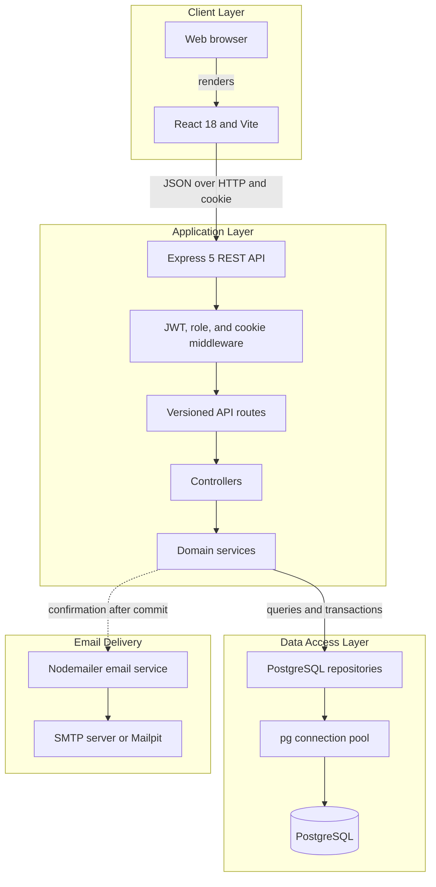
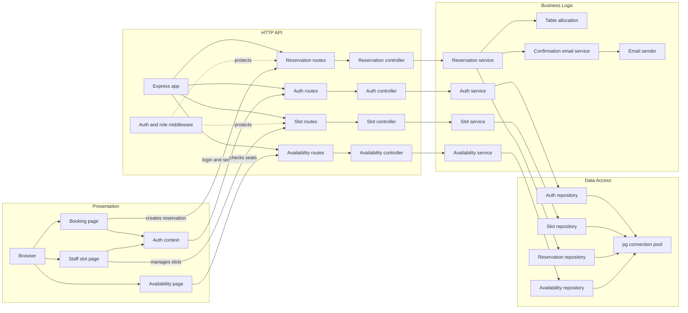

# Architecture Diagram

Mountain Hut is a client-server web application. The browser communicates with a versioned Express API, which coordinates domain services, PostgreSQL persistence, and booking-confirmation email delivery.

## Application Architecture

<!-- mermaid-checked: no \n, no em-dash/en-dash, no {} in labels, subgraphs are id["label"], arrows are -->|"label"|, all subgraphs closed by end, ids unique -->

### Technology and Data Storage

| Area | Technology | Responsibility |
| --- | --- | --- |
| Frontend | React 18, React Router 7, Vite 8, Tailwind CSS 4 | Hiker and staff user interfaces |
| Backend | Node.js, Express 5, ES modules, `tsx` | Versioned HTTP API and server startup |
| Authentication | JSON Web Tokens in HTTP-only cookies | Authenticated requests and role checks |
| Persistence | PostgreSQL through `pg` | Users, meal slots, tables, reservations, and seat allocations |
| Email | Nodemailer and React Email | Booking confirmation delivery over configured SMTP |
| Frontend tests | Vitest and Testing Library | Component and interaction tests |
| Backend tests | Node.js test runner with `tsx` | Service and API tests |

PostgreSQL is the only application database. The repository's Docker Compose configuration uses PostgreSQL 16; local development has also been verified with PostgreSQL 17. Docker is optional when a local PostgreSQL service and SMTP configuration are available. Mailpit is an optional development SMTP inbox, not a production dependency.

The schema defines seven tables: `app_user`, `slot`, `slot_table`, `reservation`, `reservation_seat`, `reservation_requirement`, and `password_reset_token`, plus the `slot_table_free` view. A slot's capacity is the sum of its table seat counts. The view derives per-table free seats from confirmed reservation allocations. Composite foreign keys in `reservation_seat` enforce that a reservation and its table belong to the same slot.

### Key Design Decisions

- HTTP routes, controllers, domain services, and repositories form separate backend layers.
- Reservation allocation is performed as a database operation; availability is an advisory query and does not hold seats.
- Confirmation email delivery follows the reservation write and is best-effort: a mail failure does not roll back a successful booking.
- No cache, queue, or ORM is used; persistence is implemented with SQL and the `pg` connection pool.

## Component Relationships

<!-- mermaid-checked: no \n, no em-dash/en-dash, no {} in labels, subgraphs are id["label"], arrows are -->|"label"|, all subgraphs closed by end, ids unique -->

### Component Inventory

| Component | Layer | Responsibility |
| --- | --- | --- |
| Booking, staff slot, and availability pages | Frontend | Collect user input and display API results |
| Auth context | Frontend | Maintain the current authenticated-user state |
| Express app and route modules | HTTP API | Configure middleware and map versioned endpoints |
| Controllers | HTTP API | Translate HTTP requests and responses to service calls |
| Auth and role middleware | HTTP API | Validate cookie-based authentication and authorization |
| Auth, slot, reservation, and availability services | Business logic | Enforce user-story rules and coordinate persistence |
| Table allocation | Business logic | Allocate party seats across the tables in a slot |
| Confirmation email service | Business logic | Render and send booking confirmation messages |
| Repositories | Data access | Execute parameterized PostgreSQL queries |
| `pg` connection pool | Data access | Reuse database connections |

See the [README architecture overview](../README.md#architecture) and [database documentation](./database.md) for the visual diagrams and schema details.
