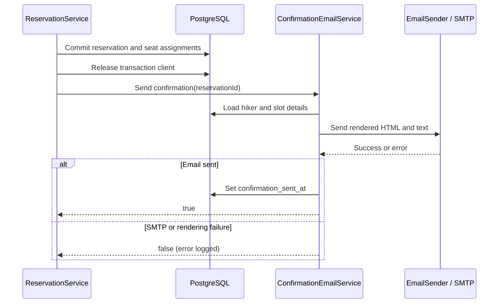

# MH-03 - Receive confirmation

- **Business value:** 980
- **Requirement source:** MH-03 (shared course requirements)

## Purpose and scope

After MH-01 creates and commits a reservation, the system attempts to email the hiker a confirmation. MH-03 is implemented as a post-booking side effect; it has no separate HTTP endpoint and does not determine whether the booking itself succeeds.

## Trigger and message contract

The trigger is a successful `POST /api/v1/reservations`. The recipient is the email address of the authenticated hiker who made the booking. The message includes:

- Booking reference `MH-<reservation id>`.
- Hiker's full name.
- Slot date and start/end times formatted in `Europe/Rome`.
- Party size.
- Party requirements when that data is available.

The implementation currently passes an empty party-requirements list because MH-05 has not yet been integrated into the reservation data path. The template omits the requirements row when the list is empty. Table numbers are intentionally not included in the email.

The subject is `Booking confirmed – MH-<reservation id>`. Both HTML and plain-text bodies are rendered from the React Email `BookingConfirmationEmail` template.

## Sequence and failure isolation

The API responds with the reservation and `confirmationSent`:

- `true` means the email send operation succeeded.
- `false` means sending failed; the reservation remains committed and the API still returns the successful booking response.
- If sending succeeds but updating `confirmation_sent_at` fails, the response remains `true` because delivery already occurred; the database error is logged.

`confirmation_sent_at` is nullable. A `NULL` value can mean that delivery failed or that the post-send timestamp update failed; check the backend log to distinguish them. The implementation has no outbox or automatic retry mechanism.

## Email transport configuration

`EmailSender` uses Nodemailer over SMTP. The backend reads `SMTP_HOST`, `SMTP_PORT`, `SMTP_SECURE`, optional `SMTP_USER`/`SMTP_PASSWORD`, and `MAIL_FROM` from `App/docker/.env`. Connection and greeting timeouts are five seconds; the socket timeout is ten seconds.

The Docker development override starts Mailpit on SMTP port 1025 and exposes its inbox at `http://localhost:8025`. In a no-Docker setup, port 1025 must be provided by a separately running SMTP test server or the environment must be configured for a reachable SMTP provider. If no server is reachable, booking still succeeds and `confirmationSent` is false.

Never commit SMTP credentials. Use a provider-specific app password or other approved secret mechanism; do not put production credentials in `.env.example`.

## Implementation and tests

- Orchestration: `App/backend/src/services/reservation.service.js`
- Confirmation service: `App/backend/src/services/confirmationEmail.service.js`
- SMTP adapter: `App/backend/src/emails/emailSender.js`
- Template: `App/backend/src/emails/confirmationEmails.jsx`
- Data query and timestamp: `App/backend/src/database/reservation.repository.js`
- Frontend result state: `App/frontend/src/components/booking/BookTableWizard.jsx`
- Tests: confirmation service, email template, sender, integration, and E2E tests under `App/backend/tests/`
- API reference: [API documentation](../api.md)

## Operational verification

For local verification, book a valid slot with an authenticated hiker, inspect the `confirmationSent` field in the `201` response, and check the configured SMTP inbox. A successful database booking with `confirmationSent: false` is not a booking failure; inspect SMTP reachability and backend logs.
